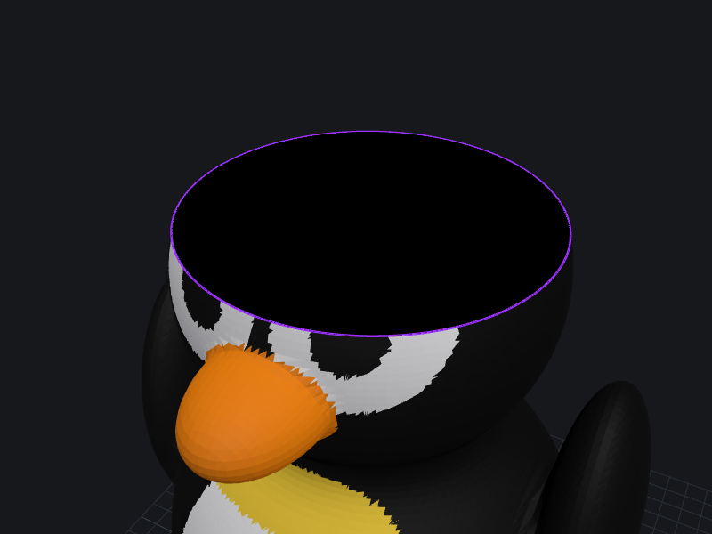
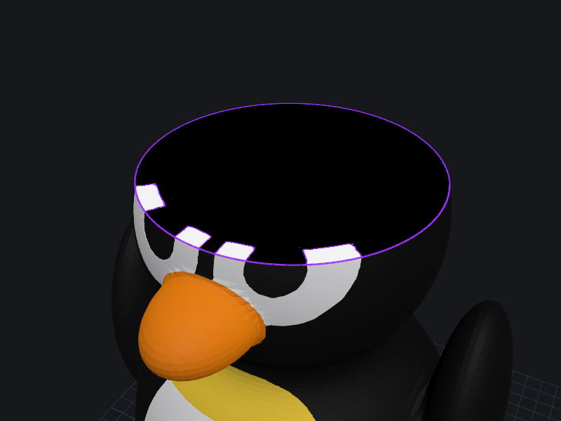
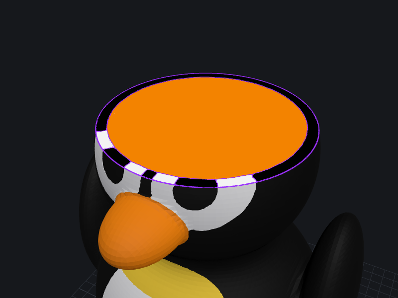
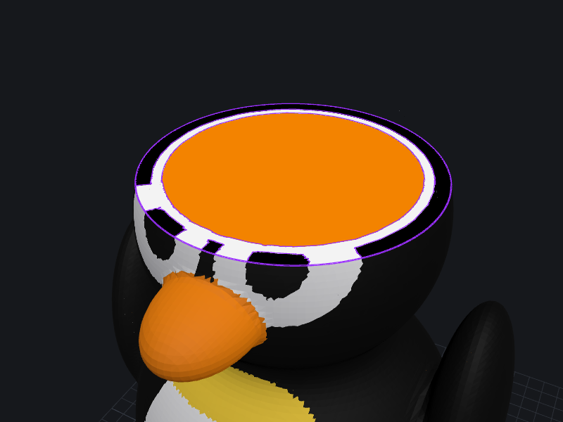
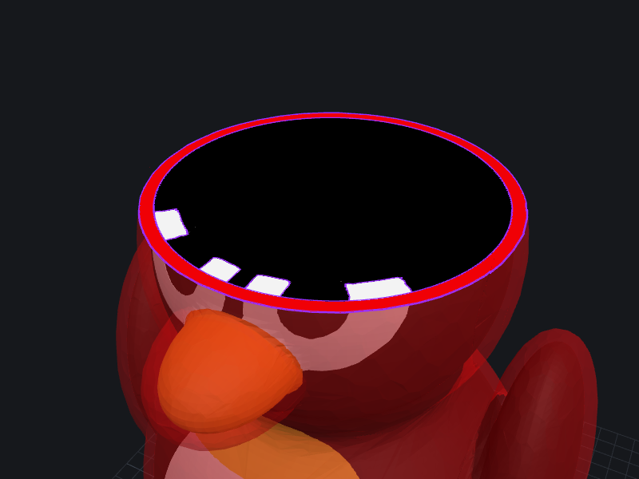

# FilaDeep

FilaDeep takes a color-painted Bambu Studio / OrcaSlicer project (`.3mf`) and
turns the paint into real solid parts, so you control how deep each color goes.
It runs entirely in the browser; nothing is uploaded.

## The problem

When you paint a model in the slicer, the slicer decides how deep each color
goes, and it often gets it wrong:

- **Dark details go too deep.** On a model in light or translucent colors, a
  dark detail such as an eye is sliced far into the body. The dark plastic then
  shows through the light plastic around it.

  <a href="img/Deep%20plastic.png"></a>

- **Light details stay too shallow.** On a dark model, a light accent is printed
  only one layer thick. That isn't enough to cover the dark plastic behind it,
  so the accent looks dull.

  <a href="img/Shallow%20plastic%20-%20model.png"></a>
  <a href="img/Shallow%20plastic%20-%20print.png"></a>

  Painted model (left) and its sliced preview (right).

Two more things are hard to do with paint alone: printing the inside in a
different material from the colored outside, and adding a layer of another
material around the whole model.

## What it does

All pictures show the penguin demo cut open at the same height.

| | |
|---|---|
|  | **Source.** The painted model as the slicer gets it: paint is only on the surface. |
|  | **Color depth.** Each color becomes a solid part with its own depth. Dark colors stay shallow, so black eyes don't show through the light plastic around them. Light colors go deeper, so white details on a dark body stay bright. |
|  | **Core.** Fill the inside with another filament (e.g. strong or cheap PLA-CF) and keep the colors as a skin of fixed thickness. The core is orange here to make it visible. |
|  | **Primer.** Add a layer between the colors and the core, e.g. white under the colors when the core is dark. |
|  | **Shell.** Wrap the model in a thin layer of another filament, e.g. clear PVB to smooth with alcohol. |

The output is a copy of your project with the new parts; all slicer settings are
kept. Filament slots must already exist in the project.

The pictures are generated by `img/gen-img.sh` (see screenshots below).

## Run it locally

Needs a recent [Node.js](https://nodejs.org/).

```bash
cd web
npm install          # once: downloads three.js, manifold-3d and fflate
node serve.mjs       # then open http://localhost:8000/
```

There is no build step: the browser loads the source files as they are, so
edit a file and reload the page.

The page opens with the `testshapes` demo. Pick options, press **RUN**, then
**Save 3MF** and open the result in your slicer.

- **Models:** open a file, drop one on the page, or use Open URL (the server
  must allow CORS). The demos are in `web/models/`.
- **Private models:** put them in the repo's `models/` folder (not in git). The
  dev server serves them too, e.g. `http://localhost:8000/#src=models/my.3mf`.
- **Links:** all options live in the address, and "Copy link" copies it, e.g.
  `#src=models/penguin.3mf&core=3&primer=4&shell=5`. Add `&run=1` to start
  processing on load.
- **Layer view:** the sliders on the right edge of both views cut the model
  from above and below, to see what's inside.

Screenshots from links, e.g. the same view and cut with different options (the
dev server must be running; needs Google Chrome):

```bash
node web/shot.mjs '#src=models/penguin.3mf&shell=5&run=1&cam=215,85,100,175,157,44&cut=,47' a.png \
                  '#src=models/penguin.3mf&core=3&shell=5&run=1&cam=215,85,100,175,157,44&cut=,47' b.png
```

Set up the view in the browser and use "Copy link": the link holds the camera
(`cam`), the cut heights (`cut=bottom,top` in mm) and the highlight mode (`hl`).
Options are listed at the top of `web/shot.mjs`.

Without a browser:

```bash
node web/bench.mjs in.3mf out.3mf --core 3 --skin 1.2 --primer 4 --shell 5
```

## Hosting

`web/` is a static site: any static host works once `npm install` has run
there. It must be served over http(s); opening `index.html` from disk does not
work.

## Python version

The same pipeline as a command-line tool, which is also where the demo models
are generated: see [`cli-python/`](cli-python/README.md).

Parked ideas and open issues: `docs/LATER.md`.
